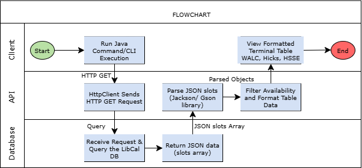

# LibCal Availability Checker

A simple tool for Purdue students to instantly check open study rooms at WALC and HSSE. Instead of browsing multiple websites, it displays a clean, organized list of available rooms on your screen.

## The Problem

Finding an open collaborative study room across Purdue’s campus requires manually navigating multiple disjointed LibCal booking portals for libraries like WALC and HSSE. This creates unnecessary friction between classes when students need quick spaces to meet or study. This project builds a centralized availability aggregator tool that queries and standardizes room schedules into a single unified interface to eliminate tedious tab-switching.

## How It Works

The CLI tool queries Purdue's LibCal grid endpoint and formats available rooms in the terminal:

1. Sends HTTP `POST` requests with form parameters (`lid`, `gid`, date range, pagination) to `https://calendar.lib.purdue.edu/spaces/availability/grid`.
2. Retrieves raw JSON slot data for target study rooms in WALC and HSSE.
3. Parses slot fields (`start`, `end`, `itemId`, `className`) manually in Java into `TimeSlot` objects (`LibCalParser`).
4. Filters slots to identify open rooms across the target buildings.
5. Renders open room availability in a formatted terminal table.



## Future Plans

1. Allow a filtering feature for users based on specific date or time window more than just current availability.
2. Allow users to search and compare by room availability.
3. Auto refresh to display the most up to date availability changes.


## Tech Stack

- **Language:** Java (JDK 17+ / `java.net.http.HttpClient`)
- **Libraries / Dependencies:** None (standard Java library only; manual `String` parsing)
- **External Tools / APIs:** Purdue Libraries LibCal backend (`calendar.lib.purdue.edu/spaces`)
- **Data Storage:** None (fetches live availability on demand without local file or database storage)

## Setup and Running

### Prerequisites
- **Java (JDK 17 or newer)** installed and available on your `PATH` (`java -version`, `javac -version`)
- **Git** installed (`git --version`)
- Internet access to reach `calendar.lib.purdue.edu`

### Clone, Compile, and Run

```bash
git clone https://github.com/AaliyaJomy/LibCal-CS193
cd LibCal-availability-checker-CS193-final
mkdir -p out
javac -d out src/*.java
java -cp out Main
```

## Example Input and Output

Example Input: 
Target buildings: WALC, HSSE

Example Output:
```bash
Status: 200
Parsed time slots: 48

Building | Room ID | Start               | End                 | Status
---------+---------+---------------------+---------------------+-------
WALC     | 107410  | 2026-11-24 17:00:00 | 2026-11-24 17:30:00 | FREE
WALC     | 107412  | 2026-11-24 17:30:00 | 2026-11-24 18:00:00 | FREE
```

## Roadmap
- [x] Inspect LibCal network traffic and verify POST availability endpoint

- [x] Fetch live JSON slot data using HttpClient

- [x] Parse LibCal JSON manually into TimeSlot objects

- [x] Filter available rooms across WALC and HSSE

- [ ] Display room availability in a CLI table

- [ ] Filter by custom user-selected date or time window (Schedule feature)

## Demo
Watch the project walkthrough here:
